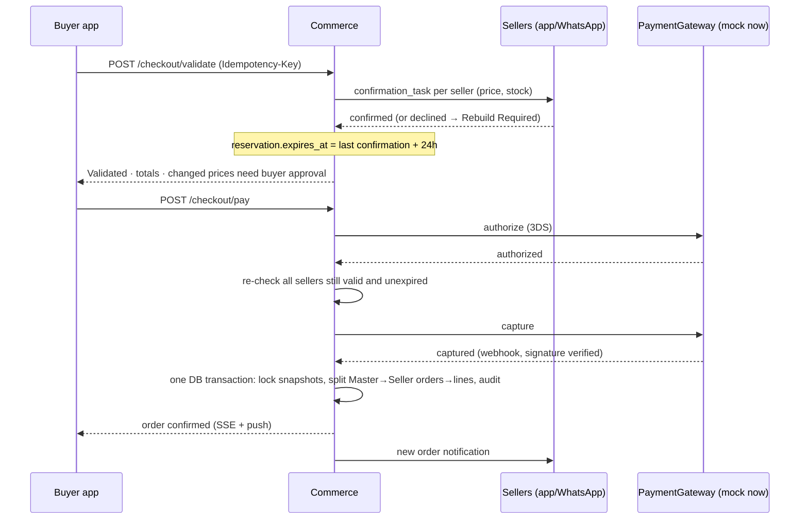

# 07 — Production architecture: buyers, sellers, web and mobile

> **Superseded in part.** This was the architecture *proposal*. Every open decision in it has since been
> made, and a few proposals were revised after checking the toolchain. **`aidooi/docs/adrs.md` is
> authoritative.** Notable changes: Fastify instead of NestJS (ADR-009); PostgreSQL as the job queue and no
> Redis at launch (ADR-012); pnpm workspaces without Turborepo (ADR-011); buyer web from the Expo codebase and
> Vite SPAs for the seller portal and ops console instead of Next.js (ADR-014); a full seller app and portal
> rather than a confirmation-only companion (ADR-002). The diagrams and flows below remain accurate.

Status: **proposal for sign-off.** Builds on `03-system-specification.md` (entities, state machines, API
surface) and `04-build-plan.md` (phases). Where this document departs from a standard (notably LOG-013's "no seller portal"), it says so in §1 and §13.

Vocabulary: **buyer** = AIDOOi *customer*; **seller** = AIDOOi *partner* (furniture retailer with one or
more `partner_location`s); **ops** = AIDOOi staff.

---

## 1. Decisions up front

| # | Decision | Why |
|---|---|---|
| 1 | **Three surfaces, one backend**: Buyer app (iOS/Android/web), Seller app + Seller portal (iOS/Android/web), Ops console (web) | Buyers and sellers have different jobs and devices. Sellers are on the shop floor with a phone; ops are at a desk |
| 2 | **Mobile = React Native (Expo)**; buyer web = Next.js; ops console = Next.js | One language (TypeScript) end to end, so the recommendation engine, state machines and types are written once and shared |
| 3 | **Modular monolith** (NestJS + PostgreSQL), not microservices | The seven layers in `03` §1 are tightly coupled by transactions (checkout → order split → snapshot). Split later along module seams, only if load demands |
| 4 | **AIDOOi is merchant of record**: one payment to AIDOOi, monthly settlement to sellers (LOG-014, WF-08) | Avoids real-time split payouts and marketplace-payments licensing complexity at launch |
| 5 | **Authorize → validate → capture** for checkout, behind a `PaymentGateway` interface with a **mock adapter for now** | Honours "no capture before all seller validations". Provider choice is deferred; swapping in a real one later touches one adapter, not the saga |
| 6 | **Host in the UAE region** (AWS `me-central-1` or Azure UAE North) | Latency for UAE users; UAE PDPL and payment-provider expectations around data residency |
| 7 | **Sellers are first-class users**: a Seller app (mobile) for time-critical tasks and a Seller portal (web) for catalogue, stock, orders and statements; WhatsApp as a fallback channel | Decided by AIDOOi. This **supersedes AID-LOG-013's "no seller portal in MVP"**; that standard should be revised (§13) |

---

## 2. System context

```
   BUYER                        SELLER                         AIDOOi OPS
 ┌──────────────┐          ┌──────────────┐              ┌──────────────────┐
 │ Buyer app    │          │ Seller app   │              │ Ops console      │
 │ iOS/Android  │          │ iOS/Android  │              │ Next.js (web)    │
 │ + web (PWA)  │          │ confirm / QR │              │ catalogue, orders│
 └──────┬───────┘          └──────┬───────┘              │ issues, settle   │
        │  HTTPS (REST + SSE)     │                      └────────┬─────────┘
        └──────────────┬──────────┴───────────────────────────────┘
                       ▼
              ┌─────────────────┐   WAF / CDN (CloudFront / Cloudflare)
              │   API Gateway   │   rate limit, TLS, bot protection
              └────────┬────────┘
                       ▼
 ┌────────────────────────────────────────────────────────────────────┐
 │                  AIDOOi Core  (NestJS modular monolith)            │
 │                                                                    │
 │  identity   catalogue   recommendation   visualization   viewing   │
 │  commerce   fulfilment  settlement       notifications   audit     │
 │                                                                    │
 │            domain package (pure TS: engine, state machines)        │
 └───┬────────────┬───────────────┬───────────────┬───────────────┬───┘
     ▼            ▼               ▼               ▼               ▼
 PostgreSQL     Redis        Job queue        Object store     Search
 (primary +     (cache,      (BullMQ →        (S3: media,      (Postgres FTS
  replica)      sessions,    SQS later)       catalogue        first, OpenSearch
                rate limits)                  imports, PDFs)   if needed)
                       │
     ┌─────────────────┼──────────────────────────────────────────┐
     ▼                 ▼                    ▼                     ▼
 PaymentGateway     WhatsApp Business    Push (FCM/APNs)     Maps, SMS/OTP,
 (mock now; real    API + SMS            + email (SES)       email, Sentry,
  provider later)                                            analytics
```

---

## 3. Client applications

### 3.1 Buyer app (the main product)

| Concern | Choice |
|---|---|
| Framework | Expo (React Native) + Expo Router; Next.js for the web/PWA build |
| State | TanStack Query for server state; Zustand for local wizard state |
| Forms | React Hook Form + Zod (schemas shared with the backend) |
| Design system | Tokens generated from AID-DATA-015 (`packages/ui-tokens`), consumed by RN and CSS |
| Visualization | `react-native-svg` rendering the measured plan; port `mvp/js/art.js` |
| Auth | Guest session token → phone OTP / Apple / Google at viewing or purchase; pending action resumed (gap #13) |
| Payments | Provider's native SDK (3-D Secure, Apple Pay, Google Pay) — card data never touches our servers |
| Push | Expo Notifications → FCM/APNs |
| Deep links | Universal/App Links for viewing QR, order status, resumed projects |
| Offline | Project draft cached locally (MMKV); the viewing pass (QR) cached so it opens with no signal |
| i18n | English + Arabic from day one; RTL layout; Dubai/AED formatting. Retrofitting RTL is expensive |
| Accessibility | WCAG 2.2 AA, Dynamic Type, screen reader labels on visualization hotspots |

Screens map 1:1 to WF-01…WF-07: path select → inputs → options → room view/product card → replace →
viewing request/pass → checkout → order tracking → issue report.

### 3.2 Seller surfaces (mobile app + web portal)

One seller identity, two clients sharing the same API. The **app** is for the shop floor; the **portal**
is for the back office.

| Capability | App (mobile) | Portal (web) |
|---|---|---|
| Viewing requests: accept/decline a stop, confirm display status | ✔ primary | ✔ |
| Purchase validation: confirm price, stock, availability inside the 24-hour window | ✔ primary | ✔ |
| QR check-in: scan Viewing ID, mark attended / no-show | ✔ primary | – |
| Order lines: Preparing → Ready → Dispatched, with delivery proof photo | ✔ | ✔ |
| Issues inbox: view and respond to flagged lines | ✔ | ✔ |
| **Catalogue & offers**: submit products, edit price, stock, delivery days, viewing status | quick stock/price edit | ✔ full, plus bulk CSV/Excel import and import error reports |
| **Store profile**: locations, opening hours, contacts, after-sales terms (gap #10) | – | ✔ |
| Team: invite staff, assign location, roles | – | ✔ |
| Statements, settlement history, commission breakdown, tax invoices | read | ✔ |
| Performance: confirmation response time, fulfilment rate, issue rate | summary | ✔ |

**What sellers can and cannot change** (protects the standards):

- Sellers submit products and edit **their own offers** (price, stock, delivery, viewing status).
  New or changed product data goes to `Ready for Review`; **only ops can mark it `Verified`**
  (DATA-014), so nothing a seller types reaches recommendation unreviewed.
- Price changes take effect immediately for new recommendations but never alter an open reservation or
  a locked order snapshot.
- Sellers cannot see or edit `commission_rate`, other sellers' offers, or buyer PII beyond what a
  confirmed order/viewing requires (name, phone, delivery address, viewing time).
- Stale `viewing_confirmed_at` automatically triggers a reconfirmation task (LOG-012 §4).

Roles: `seller_owner`, `seller_manager` (catalogue + orders), `seller_staff` (viewings, fulfilment),
scoped to `partner_id` and optionally a `partner_location_id`. Enforced by policy layer and Postgres RLS.
Every action writes `audit_event` with the seller user as actor.

**Onboarding flow:** partner request → ops review → agreement → ops activates (`Requested → … → Active`,
unchanged from LOG-013) → owner receives invite → completes profile → uploads first catalogue → ops
verification queue → live. Activation stays a manual ops gate.

**Fallback channel:** every task is also sent as a **WhatsApp Business** message with quick-reply
buttons. Replies post to the same confirmation endpoint, so the state machine has one entry point
whatever the channel.

### 3.3 Ops console (web)

Partner onboarding and activation; seller user management; product verification queue (AID-DATA-014); catalogue import review;
price/offer admin; style/colour map versioning; order and issue desk; telephone-status capture with
who/when; settlement runs and statements; role-based access and an audit viewer.

---

## 4. Repository layout (monorepo, pnpm + Turborepo)

```
aidooi/
├─ apps/
│  ├─ buyer-mobile/        Expo app (iOS, Android)
│  ├─ buyer-web/           Next.js (PWA, SEO landing)
│  ├─ seller-mobile/       Expo app
│  ├─ seller-portal/       Next.js (catalogue, stock, orders, statements)
│  ├─ ops-console/         Next.js
│  └─ api/                 NestJS core
├─ packages/
│  ├─ domain/              pure TS: engine, scoring, composition, state machines, money
│  ├─ contracts/           OpenAPI + Zod schemas → generated TS client
│  ├─ ui-tokens/           AID-DATA-015 tokens
│  ├─ ui-native/ ui-web/   shared components
│  └─ config/              eslint, tsconfig, prettier
├─ infra/                  Terraform (VPC, RDS, ECS, S3, CloudFront, secrets)
├─ data/                   taxonomy, compatibility maps (versioned), seed catalogue
└─ .github/workflows/
```

`packages/domain` is the key asset: `mvp/js/engine.js`, `standards.js`, `commerce.js` port into it with
types. The same code runs in the API (authoritative) and the apps (instant what-if previews).
**The server's answer always wins**; the client never decides eligibility or price.

---

## 5. Backend modules

Each module owns its tables, exposes a typed service interface, and never reads another module's tables
directly (enforced with lint rules). That is what makes later extraction cheap.

| Module | Owns | Notes |
|---|---|---|
| `identity` | customer, guest_session, seller_user, ops_user, roles | OTP, OAuth, JWT access (15 min) + rotating refresh |
| `catalogue` | parent_product, product, seller_offer, brand, taxonomy, media, partner, partner_location | Seller submission + ops verification workflow, ingestion pipeline, eligibility gate as a **database view** so no code path can bypass it |
| `payments` | payment, payment_attempt, refund, ledger | `PaymentGateway` port; `MockGateway` adapter now (simulates 3DS, declines, auth expiry, duplicate webhooks); real adapter later |
| `recommendation` | project, project_module, recommendation_run, candidate_score, composition | Calls `domain` engine; persists rejections |
| `visualization` | visualization, hotspot map | Concept mode (LOG-011); pluggable renderer |
| `viewing` | viewing_request/stop/product/deposit, attribution | Deposit rules in `domain` |
| `commerce` | purchase_request, reservation, payment, master/seller/order_line | Checkout saga (§7) |
| `fulfilment` | line state, issue | 72-hour auto-confirm via scheduled job |
| `settlement` | settlement_run, statement | Monthly job; pure function over locked snapshots |
| `notifications` | device_token, template, delivery log | Channel routing: push → WhatsApp → SMS → email |
| `audit` | audit_event (append-only) | Written in the **same transaction** as the state change |

**API style:** REST + OpenAPI (generated client for all three front ends), SSE for live status
(confirmation arrived, payment result). GraphQL adds nothing the eight workflows need.
Versioned under `/v1`; mobile apps need a **minimum-supported-version** gate because old binaries live
for months.

---

## 6. Data architecture

- **PostgreSQL 16**, one primary, one read replica, PITR backups, encrypted at rest. Schema = `03` §2–7.
- **IDs**: `AIP/AID/AIO-########` from global sequences, never reused (DATA-005). Internal UUIDs for
  everything else.
- **Money**: integer fillér (AED × 100) in the DB, a `Money` type in `domain`; never floats.
- **Snapshots**: `order_line.snapshot` is JSONB written once at payment success, protected by a trigger
  that rejects UPDATE.
- **Audit**: `audit_event` partitioned monthly, append-only (revoked UPDATE/DELETE).
- **Concurrency**: stock reservation uses `SELECT … FOR UPDATE` on `seller_offer` rows; reservation expiry
  by scheduled job.
- **Search/browse**: Postgres full-text + trigram first (catalogue is hundreds to low thousands of
  products). Move to OpenSearch only if measured need.
- **Media**: S3 + CDN, signed upload URLs, image variants (thumb/card/zoom) generated async, AVIF/WebP.
- **Analytics**: events to a warehouse (BigQuery/Redshift) via the outbox; product analytics via PostHog.
- **Catalogue ingestion**: partner CSV/Excel/API feed → `import_job` → validation against DATA-001…014 →
  ops review → promote to `Verified`. Row-level error report returned to ops. **This is the long pole of
  the whole project** (see `04` risk notes).

### Added entities beyond `03`

`seller_user`, `device_token`, `notification`, `import_job`, `import_row`, `confirmation_task`
(type, partner_id, due_at, channel, response, responded_by), `idempotency_key`, `outbox_event`,
`compat_map_version`, `feature_flag`.

---

## 7. The two flows that must be correct

### 7.1 Checkout saga (LOG-014)



The gateway interface is `authorize / capture / void / refund / parseWebhook`. The mock implements all
five with switchable failure modes, so every gate below is testable today with no provider account.

Rules enforced in code and tested as acceptance gates:

- No capture until every required `confirmation_task` is confirmed and unexpired.
- No seller notification of an order until payment is `Successful`.
- No partial multi-seller success: if any seller fails after authorization, **void the authorization**.
- Every endpoint idempotent (`Idempotency-Key`); webhooks de-duplicated by provider event ID.
- Nightly **reconciliation** of provider payouts against `payment` rows (a no-op against the mock until a provider exists).

### 7.2 Viewing and deposit

`Draft → Awaiting Seller Confirmation → Awaiting Deposit → Confirmed → Completed / No-show / Cancelled`.
Deposit = `MIN(5% × Σ selling_price, AED 500)`, captured via the provider. Outcome → refund / credit
against the order / forfeit, each a ledger entry (not an edited balance). QR token is a signed,
short-lived JWT scoped to one viewing; scanning is idempotent.

### 7.3 Time-based rules need a durable scheduler

24-hour reservation expiry, seller response SLAs, 72-hour receipt auto-confirm, monthly settlement,
viewing reconfirmation staleness. Implement as **delayed jobs backed by Postgres rows** (the row is the
truth; the queue only wakes it) so a Redis loss cannot silently skip an expiry. Reassess Temporal if
workflows multiply.

---

## 8. Recommendation service

- The engine is deterministic: same project + same catalogue version + same map version → same output.
  Persist `catalogue_version` and `compat_map_version` on every `recommendation_run`.
- Hard filters in SQL (eligibility view, category, fit bounds) → candidate set → scoring in `domain`
  (LOG-009 weights) → composition (LOG-010) → four options.
- Latency target: p95 < 2 s for a room, < 6 s for a villa; villa runs asynchronously with progress via SSE.
- Cache candidate sets per (slot, size_class, catalogue_version) in Redis.
- **No LLM in the scoring path** (LOG-009 §12 mandates controlled maps). An LLM may be used *only* for
  the optional conversational front door (free-text → structured project inputs), validated by Zod
  before it touches the engine, and always user-confirmable.
- Golden-fixture tests: a fixed catalogue + fixed projects with expected outputs, run on every PR.

---

## 9. Security, privacy, compliance

| Area | Control |
|---|---|
| Transport/edge | TLS 1.2+, HSTS, WAF, rate limits per IP/user/route, bot protection on OTP |
| AuthN | OTP + OAuth; refresh-token rotation with reuse detection; device binding for seller app |
| AuthZ | RBAC + row-level scope (a seller can only ever see their own `partner_id`); enforced in a policy layer **and** Postgres RLS for seller-scoped tables |
| Payments | Mock only for now. When a provider is added: PCI SAQ-A, hosted fields/native SDK only; no PAN, ever, in logs or DB. The buyer app's pay screen is built against the gateway interface so it won't change |
| Data protection | UAE PDPL: consent records, data-subject export/delete, retention schedule, DPA with every processor |
| Secrets | AWS Secrets Manager; no secrets in the repo or in app bundles |
| Mobile | Certificate pinning (with rotation plan), jailbreak/root signal (log, don't block), secure storage for tokens, no PII in push payloads |
| Uploads | Signed URLs, content-type sniffing, size limits, malware scan on partner catalogue files |
| Audit | Append-only; ops access to PII is itself audited |
| Supply chain | Lockfile, Dependabot, `npm audit`/Snyk in CI, pinned base images, SBOM |
| VAT | 5% UAE VAT on invoices; tax-invoice PDF generated per seller order |

---

## 10. Infrastructure and delivery

- **Runtime**: AWS ECS Fargate (API + worker as separate services, same image), RDS PostgreSQL Multi-AZ,
  ElastiCache Redis, S3, CloudFront, SES, Secrets Manager. Terraform for everything.
- **Environments**: `dev` (preview per PR), `staging` (mirrors prod, provider sandbox), `prod`.
  Seed data from `mvp/js/catalogue.js` generator for dev/staging only.
- **CI** (GitHub Actions): typecheck → lint → unit → domain golden fixtures → API integration tests
  (Testcontainers Postgres) → contract check (OpenAPI diff, breaking change blocks) → build.
- **Mobile CD**: EAS Build + EAS Submit; **EAS Update** (OTA) for JS-only fixes; TestFlight / Play
  internal tracks; staged rollout (5% → 25% → 100%). Remember Apple review lead time in the plan.
- **Backend CD**: blue/green on ECS, DB migrations backward-compatible (expand → migrate → contract).
- **Observability**: OpenTelemetry → Grafana/Datadog; Sentry for API and both apps; structured JSON logs
  with a correlation ID passed from the app; dashboards for checkout success rate, seller confirmation
  latency, payment/capture mismatches, job lag.
- **SLOs**: API availability 99.9%; checkout success ≥ 97% of valid attempts; seller confirmation task
  delivery < 60 s; RPO 5 min, RTO 1 h.
- **Capacity (launch)**: assume ≤ 5k MAU, ≤ 100 concurrent. Two API tasks and one worker is enough;
  design for horizontal scale but don't pay for it yet.

---

## 11. Testing strategy

| Layer | What | Where |
|---|---|---|
| Unit | Scoring, composition, deposit maths, state-machine transitions, money | `packages/domain` (property-based tests for money and settlement) |
| Acceptance gates | One automated test per row of `03` §9 / Master Plan §9 | API integration suite |
| Contract | OpenAPI diff + generated-client typecheck | CI |
| Payments | MockGateway failure modes: 3DS, declines, partial failures, duplicate webhooks, auth-expiry (re-run against the provider sandbox later) | CI + staging, nightly |
| E2E mobile | Maestro flows: profile → recommend → viewing → pay | Real device farm (BrowserStack / Firebase Test Lab) |
| E2E web | Playwright | CI |
| Load | k6: recommendation, checkout burst, seller confirmation fan-out | Pre-launch |
| Security | SAST, dependency scan, annual pen test before public launch | |
| Data | Catalogue import validators with a corpus of deliberately bad files | |

---

## 12. Delivery roadmap

Team assumption: 1 tech lead/architect, 2 backend, 2 mobile/frontend, 1 designer, 1 QA, 1 part-time
DevOps, 1 product owner, plus an **ops/data person who owns catalogue quality** (this is a role, not a
task). Durations are planning estimates, not commitments.

| Phase | Weeks | Delivers | Exit criterion |
|---|---|---|---|
| **0 · Decisions & foundations** | 1–3 | Open decisions (§13), monorepo, CI/CD, infra skeleton, design system, Arabic/RTL decision | Hello-world deployed to staging; both apps in TestFlight/Play internal |
| **1 · Data & identity** | 3–9 | Schema, migrations, auth + guest upgrade, seller accounts/roles, **seller portal v1 (profile, catalogue, offers, import)**, ops console v0, verification queue | 100+ verified real products loaded by a real seller through the portal |
| **2 · Profiling + recommendation** | 8–14 | All 8 paths in the buyer app, engine ported to `domain`, persisted runs, concept visualization | Golden fixtures green; four options on real data |
| **3 · Commerce** | 12–18 | `PaymentGateway` + mock, checkout saga, order split, seller app (confirmations, validation), WhatsApp channel | All payment gates pass against the mock, including failure paths |
| **4 · Viewing** | 16–21 | Stops, deposit ledger, QR pass, seller check-in, attribution | Full viewing → purchase credit round trip on real devices |
| **5 · Fulfilment & settlement** | 19–23 | Line state machine in seller app/portal, issues, auto-confirm, settlement run, seller statements and performance, tax invoices | Month-end settlement matches a hand calculation |
| **6 · Hardening & launch** | 23–28 | Load/pen test, store review, accessibility pass, runbooks, pilot with 2–3 partners | Pilot cohort completes real orders; go/no-go review |
| **Later · Real payments** | when provider chosen | Write one `PaymentGateway` adapter, KYC, sandbox re-run of the gate tests, reconciliation | Gates green against the provider sandbox |

Parallelism: Phases 2 and 3 overlap because commerce depends on the catalogue, not on recommendation.
The critical path is **seller catalogue data → app store review**. Start the store accounts in week 1.
Payment provider KYC is off the path until a provider is chosen, but **it must be done before any
real-money launch**; the pilot can only run with simulated payments until then.

---

## 13. Decisions needed from AIDOOi (these block the plan)

| # | Decision | Recommendation |
|---|---|---|
| D1 | ~~Seller app vs LOG-013 "no seller portal"~~ | **Decided: sellers get an app and a portal.** Action: revise AID-LOG-013 and the Master Plan §7 "Operations/Admin" row so the standards match the product; ops still owns activation, verification and commission |
| D2 | ~~Payment provider~~ | **Deferred.** Build against `PaymentGateway` + mock. Revisit before any real-money pilot |
| D3 | Cloud region/provider | AWS `me-central-1` unless the client has an Azure agreement |
| D4 | Arabic + RTL at launch | Yes. Costly to retrofit |
| D5 | Native apps at launch, or PWA first | Native buyer app + PWA. Camera/QR, push, wallet pay and store presence matter for trust |
| D6 | Open items in `05` — style/colour maps owner, villa budget rule, AID-VIS-001 scope, bedroom consistency | Must be closed before Phase 2 exits |
| D7 | Who owns catalogue data quality | Name a person before Phase 1 |
| D8 | Deposit cap interpretation (per request vs per stop vs per period) | Per request, as implemented |
| D11 | Can sellers self-register, or invite-only at launch | Invite-only; ops activates (as LOG-013) |
| D12 | Seller catalogue input: CSV/Excel template only, or also feed/API integration | Template + portal at launch; API later |
| D9 | Delivery/logistics: partner-delivered (as spec) vs AIDOOi-managed | Partner-delivered for MVP |
| D10 | Legal: seller agreement, buyer T&Cs, returns policy per partner, privacy notice | Start counsel in week 1 |

---

## 14. What we need to have in hand to start

**Accounts and access:** Apple Developer Program (organisation, needs D-U-N-S), Google Play Console,
cloud account, GitHub org, WhatsApp Business (Meta business verification takes
days to weeks), Sentry, Expo/EAS, domain + DNS, Google Maps key, SMS/OTP provider (UAE sender-ID
registration).

**Content and data:** logo/brand assets, real partner catalogues (≥ 2 partners), product photography
(the MVP draws products; real photos need a shoot or partner supply), partner locations with opening
hours, legal documents, Arabic translations/translator.

**Artifacts to produce next (in order):**
1. OpenAPI spec for the `03` §8 surface plus seller app/portal endpoints (offers, imports, team, statements).
2. SQL migrations for `03` + §6 additions.
3. Monorepo scaffold with the `domain` package and ported engine, tests running.
4. Figma for buyer, seller and ops (start from the working MVP screens).
5. Threat model and data-protection impact assessment.
6. Runbooks: payment mismatch, seller non-response, stuck reservation, refund failure.

---

## 15. Risks specific to the buyer/seller/mobile shape

| Risk | Mitigation |
|---|---|
| Sellers don't respond in time → checkout and viewing stall | WhatsApp first, push second, escalate to ops phone call at 50% of SLA; expose response-time metrics from week 1; the 24-hour window is the buffer |
| Old app versions call changed APIs | `/v1` stability, min-version gate, additive-only changes, OTA for JS fixes |
| App store rejection or delay | Submit early builds in Phase 0; follow payment/IAP rules (physical goods are exempt from in-app purchase, state that clearly in review notes) |
| Card auth expires before capture (auth holds are time-limited) | Keep validate→pay window within provider's hold period, or re-authorize; test auth-expiry explicitly |
| Duplicate payments from flaky mobile networks | Idempotency keys, client retries with the same key, server-side dedupe |
| Catalogue quality limits recommendation quality | Verification gate with a named owner; import error reports; do not lower thresholds |
| Sellers publishing bad data, or seller-set price/stock drifting from reality | Seller edits are offers only; product data needs ops `Verified`; stale-confirmation reconfirmation tasks; bulk-import validation with row-level errors; seller performance metrics |
| Seller portal grows into a full ERP | Scope fixed in §3.2; order management and inventory sync via API are later decisions |
| Single-region outage | Multi-AZ now; documented cross-region restore; revisit after launch |

---

## 16. Architecture decision records (summary)

| ADR | Decision | Alternatives rejected |
|---|---|---|
| 001 | TypeScript everywhere | Kotlin/Swift native + Java backend: no shared domain code, double the engineers |
| 002 | React Native (Expo) | Flutter: strong, but loses sharing the engine and Zod schemas with the backend and web |
| 003 | Modular monolith | Microservices: distributed transactions across checkout for no launch-scale benefit |
| 004 | PostgreSQL as system of record, jobs backed by rows | Event-sourcing: audit needs are met by `audit_event` + snapshots |
| 005 | REST + OpenAPI + SSE | GraphQL: no client-shaped query problem; WebSockets: more infra than SSE needs |
| 006 | Authorize/capture with AIDOOi as merchant of record, behind a `PaymentGateway` port (mock first) | Marketplace split payments at capture: payout licensing and refund complexity, not required by LOG-014. Hard-wiring a provider now: premature |
| 007 | Deterministic engine, no LLM scoring | LLM ranking: violates LOG-009 §12, untestable against gates |
| 008 | Native apps + PWA | PWA only: weaker push on iOS, no wallet-grade payment UX, less trust |
